# Training-free Special Reasoning Enhancement

## CVPR 2026

### [Abstract 3D Perception for Spatial Intelligence in Vision-Language Models](https://openaccess.thecvf.com/content/CVPR2026/html/Liu_Abstract_3D_Perception_for_Spatial_Intelligence_in_Vision-Language_Models_CVPR_2026_paper.html)

**核心思想**：如果想让vlm真正理解三维空间，光让它看二维图片、再用语言推理可能还不够；我们可以先给它搭建一个简化的三维空间，让它在这个空间里理解物体的位置、大小和运动关系。

根据图片，询问哪一个视角和任务最相关，利用video diffusion生成对应的多视角图像，用vlm提取出视角中和问题最相关的物体，分割，选取固定数量代表性像素，用深度估计模型，获得这些像素对应的深度信息，以及相机参数。通过三维反投影，把二维像素坐标转换成三维空间中的点。多视角检查等等，筛选，利用 PCA 等方法拟合有方向的三维包围盒，最后给他退后2m视图和俯视图，SAT、BLINK、EmbSpatial Bench 和 PhysBench评估有效。

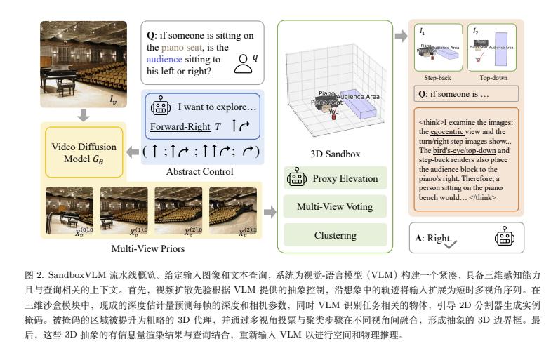

**局限**：小物体建模困难，依靠video diffusion可能存在幻觉，计算量大，依靠vlm选择最佳相机视角可能放大错误？直接用box建模，移动物体推理怎么办？利用工具来提取信息，准确度怎么样？

### [Geometrically-Constrained Agent for Spatial Reasoning](https://openaccess.thecvf.com/content/CVPR2026/html/Chen_Geometrically-Constrained_Agent_for_Spatial_Reasoning_CVPR_2026_paper.html)

**核心思想**：它们可能知道某种空间关系在语义上意味着什么，却无法可靠地把这种理解转化为正确的几何计算。为了解决这个问题，GCA 不仅让模型调用计算工具，还要求它在计算之前，先明确规定究竟要计算什么、应该站在哪个参考系中计算。

先固定参考系，约束任务目标，agent用ReAct 风格迭代执行，用了vggt,grounding dino,sam2,orient anything,moge2

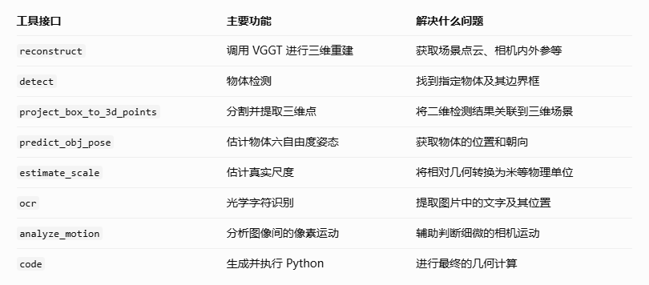

然后kacg，知识增强代码生成，给他一个准备好的公式库，让他根据任务用库里的公式写代码，计算相对位置等信息，最终评测mmsibench,mindcubetiny,omnispecial,spbench,cvbench都提分，还写了消融实验和错误归因

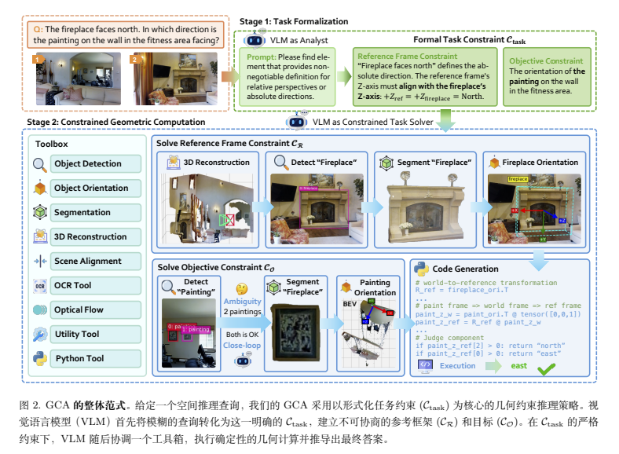

### [Keep it SymPL: Symbolic Projective Layout for Allocentric Spatial Reasoning in Vision-Language Models](https://openaccess.thecvf.com/content/CVPR2026/html/Jang_Keep_it_SymPL_Symbolic_Projective_Layout_for_Allocentric_Spatial_Reasoning_CVPR_2026_paper.html)

**核心思想**：不要直接让模型在复杂的真实图片里判断空间关系，而是先把场景转换成一张简单、标准化、颜色编码的二维符号布局图，再让模型回答。

反投影：像素坐标+深度+相机内参 （+外参可得世界坐标）

先把物体分成观察者和目标物体，然后用grounding dino提取边界框，depthpro估计深度和相机内参，反投影到三维空间，用orientanything,估计观察者朝向向量，选一个最适合的三视图，把观察者放到中间，画一个符号图，用线或者圆二划分，涂色，根据这个抽象出来的图来回答问题。在comfort,3dsrbench,cocospatial等图片数据集上提点。

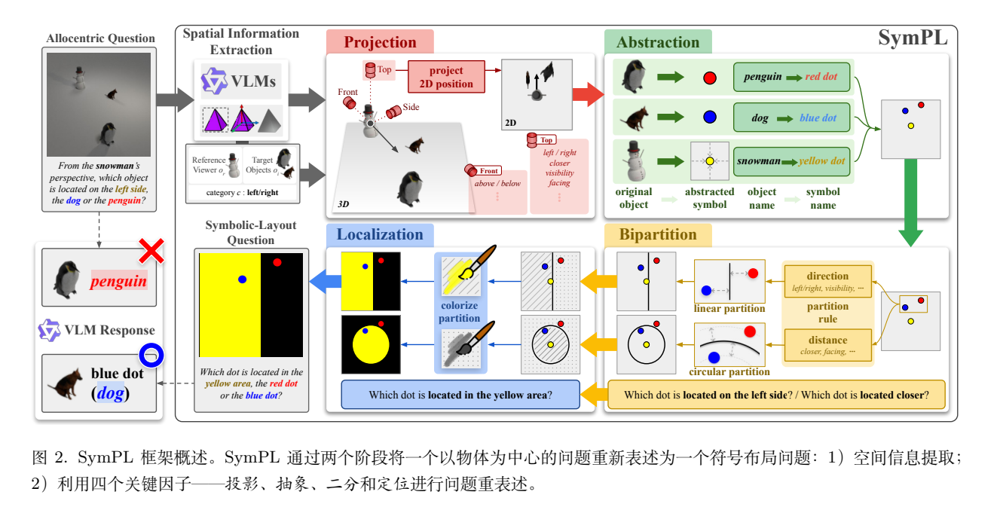

### [SpaceTools: Tool-Augmented Spatial Reasoning via Double Interactive RL](https://openaccess.thecvf.com/content/CVPR2026/html/Chen_SpaceTools_Tool-Augmented_Spatial_Reasoning_via_Double_Interactive_RL_CVPR_2026_paper.html)

**核心思想**：让模型自主调用视觉工具，逐步收集足够的证据，用强化学习来增强。

非trainingfree,先用sonnet还有专家模型采集数据，然后rl（grpo) sft qwen学习调用工具和实际操作，不仅在空间推理benchmark提点，还能用大模型+agent实际操控机械臂，某些任务超过gpt5

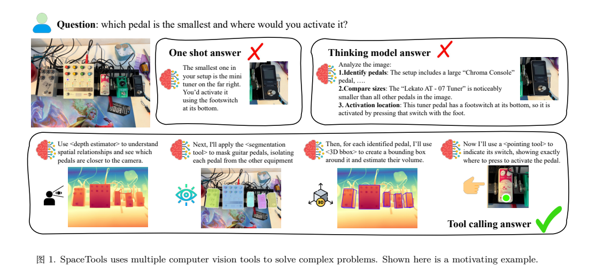

### [Token Warping Helps MLLMs Look from Nearby Viewpoints](https://openaccess.thecvf.com/content/CVPR2026/papers/Lee_Token_Warping_Helps_MLLMs_Look_from_Nearby_Viewpoints_CVPR_2026_paper.pdf)

**核心思想**：不重新生成图片，也不训练一个新的三维模型，而是直接对 MLLM 内部的图像 Token 进行几何变换，让模型能够从一个新的、相邻的视角理解原来的场景。

首先人为扰动视觉 Token 对应的图像取样位置，观察模型的空间问答能力是否下降。发现下降轻微，提出token warping,输入原始图片，深度图，相机内参，相对位姿，先反投影，再后向变换，对变换后位置取出原始token重排，交给mllm推理

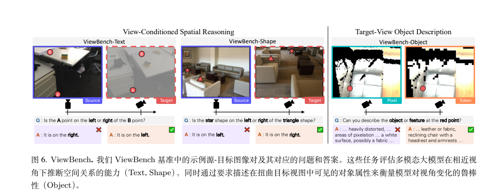

**问题**：有些点找不到原始token，直接忽略掉会不会引入噪声？可不可以对重建图进行后处理？逐像素变换已经有较好的提升，那逐像素+其他呢，从背面或者大角度的地方观察，大部分token是空的，为什么还有效果呢，这样可不可以提取出来最有用的几个token？对于特定任务比较好

## ICLR 2026

### [Pursuing Minimal Sufficiency in Spatial Reasoning](https://proceedings.iclr.cc/paper_files/paper/2026/file/c4ff64d68ba491b9048f00d25690d363-Paper-Conference.pdf)

**核心思想**：不急着让 VLM 自己理解整个三维场景，而是先用专业的三维感知工具提取与问题有关的信息，再让模型反复筛选这些信息，直到只剩下“回答问题必需、同时又足够”的证据。

俩agent,一个感知agent调用vggt,grounding dino,sam2等工具，一个制定解题计划，筛掉无用信息，还有一个sog模块

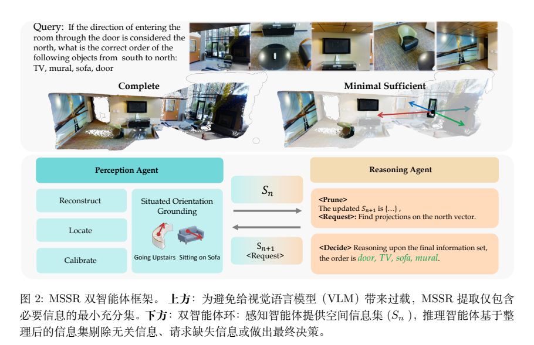

## EMNLP 2026

### [SATURN: Symbolic Spatial Reasoning for Multi-Perspective Grounding](https://aclanthology.org/2026.emnlp-main.2475/)

**核心思想**：把三维场景交给几何计算，把“左边、右边、前面、后面”等关系交给带有视角意识的符号程序，再把语言模型的不确定性保留下来。

先解析问题，找出需要的物体，用工具提取信息，提出软空间谓词，先规定参考系，计算一个0-1的软分数，用大模型写代码计算，然后得到结果，

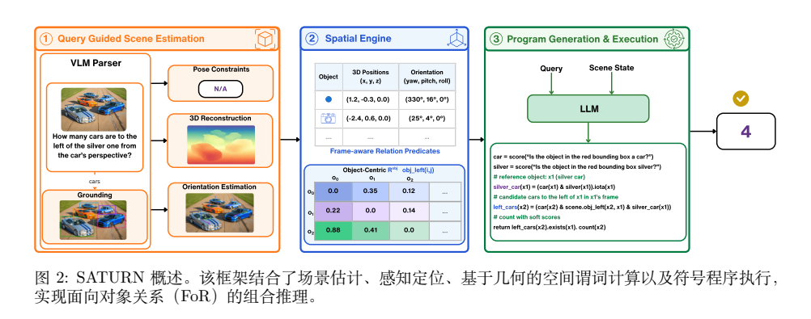

## NeurIPS 2026

### [From Views to Worlds: Active Exploration over 3D Worlds for Vision-Language Models](https://arxiv.org/abs/2610.24676)

**核心思想**：现有视觉语言模型（VLM）有一个根本局限：它们通常是被动观察图片，然后直接回答问题。但很多空间推理任务，需要模型主动获取目前看不到、或者无法直接从图片中读出的空间信息。先利用多张图片构建一个显式的三维世界，然后让模型在这个世界里主动探索，按需获取新的视觉证据和三维空间信息。

先估计深度内参等，重建三维世界，做视觉和语言接口，主动探索

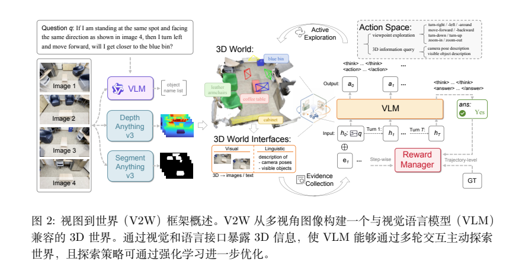

## arXiv 2026.8.5

### [Trace, Verify, and Correct](https://arxiv.org/abs/2608.04759)

**核心思想**：不仅要检查最终答案是否正确，还要检查模型得出答案时使用的空间证据是否真实可靠。空间推理中的错误会沿着推理链传播。

两个模块，seg从推理链中提取空间信息，sera负责诊断出错

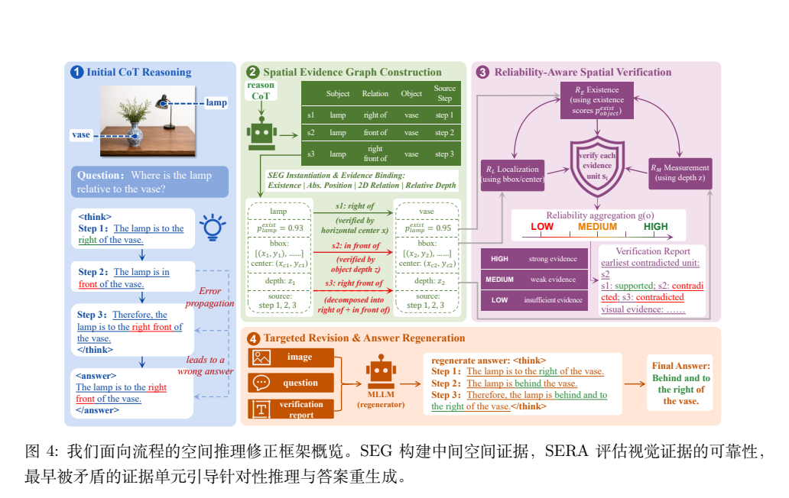

## arXiv 2026.8.3

### [SpatialQuery](https://arxiv.org/abs/2608.01709)

**核心思想**：先从单张图片中恢复物体的近似三维位置，再把整个场景转换成俯视图，让 VLM 根据更容易理解的几何布局进行推理。

## arXiv 2026.9.3v1

### [GraFT: A Training-Free Framework for Spatial Reasoning in Multimodal Large Language Models via 3D Scene Graphs](https://arxiv.org/abs/2609.03892)

**核心思想**：先构建一个三维场景图，再根据问题类型，给 VLM 提供最适合的几何数据、俯视图或第一人称图片。

构建3dsg，每个物体保存多个信息，然后用符号模块，俯视图，帧检索模块

他用的是UniDet3D 和 Mask3D这种3d目标检测模块

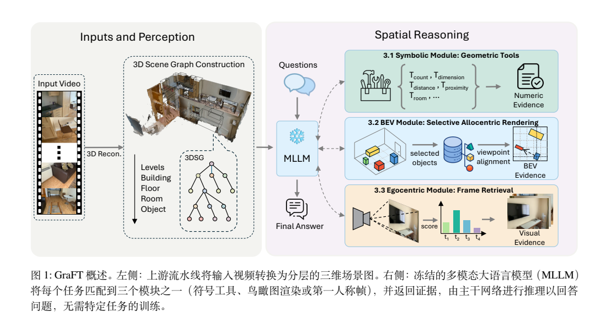

## arXiv 2026.9.21

### [INTCORT](https://arxiv.org/abs/2609.24813)

**核心思想**：通过改变输入图片和问题，生成多个空间推理结果，再根据模型对空间关系词的置信度，选择更可信的答案。

先筛出空间问题，再对问题，图片等进行翻转，发现模型可能答对，而且置信度更高

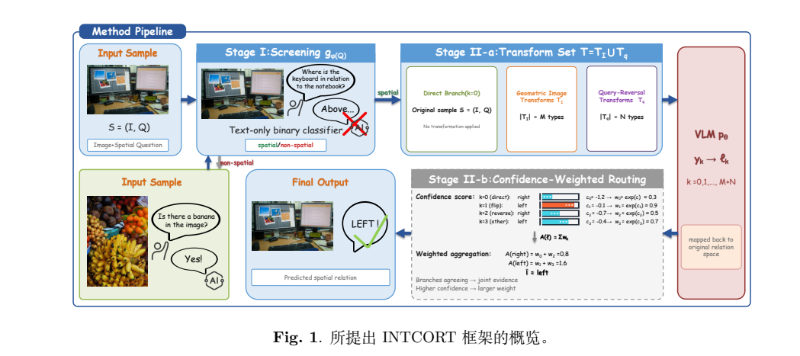

## arXiv 2026.10.1

### [From Reasoning Failures to Composable Video Spatial Intelligence](https://arxiv.org/abs/2610.01999)

**核心思想**：先系统分析 VLM 为什么会答错空间问题，再把常见错误对应的几何计算写成可复用的程序，让模型调用这些程序，而不是每次都自己从头推理。

先归纳了四种错误，再做了一个工具库，设计算子，组合成技能

## ICLR 2026

### [pySpatial: Generating 3D Visual Programs for Zero-Shot Spatial Reasoning](https://arxiv.org/abs/2603.00905)

**核心思想**：让 VLM 自己编写 Python 程序，调用三维重建、相机移动和新视角渲染工具，在一个可以探索的三维场景中寻找答案。

Agent化，构建三维场景后自主探索，找答案

## ICML 2026

### [Reason, Then Re-reason: Cross-view Revisiting Improves Spatial Reasoning](https://proceedings.mlr.press/v306/ma26z.html)

**核心思想**：先让 VLM 看原始视频、给出一个初步判断，再根据视频重建出的三维几何生成一个新的虚拟视角，让 VLM 重新检查并修正答案。

用vggt重建三维点云，然后斜向轨迹扫出一段视频，

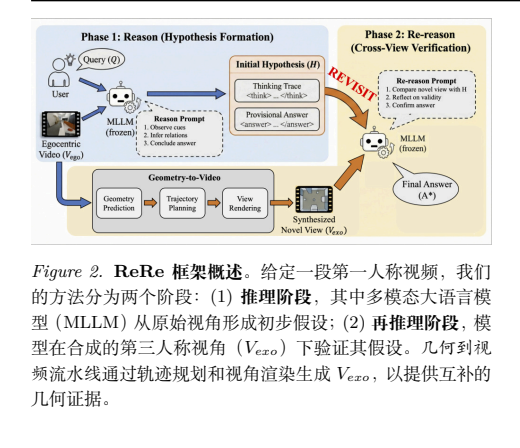

### [World2Mind: Cognition Toolkit for Allocentric Spatial Reasoning in Foundation Models](https://arxiv.org/abs/2603.09774)

**核心思想**：人走进一个房间时，最初看到的是以自己为中心的局部画面，但逐渐会形成一张不依赖当前朝向的环境地图。World2Mind 希望让 VLM 也获得类似的能力。

三阶段推理链，纯文本模型用它的方法也可以推理

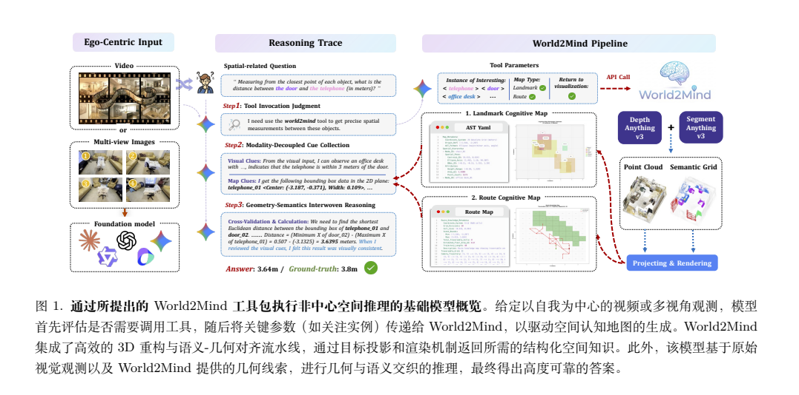

## arXiv 2026.10.8

### [Seek-and-View Reasoning for Multi-View Spatial Understanding](https://arxiv.org/abs/2610.11810)

**核心思想**：不是训练模型记住更多三维知识，而是让模型学会：当前视角不够用时，应该换到哪里观察。

## 调研笔记

- 三维重建
- 计算替代推理
- 探索，agent，工具库
- 抽象insight
- 多轮交互验证
